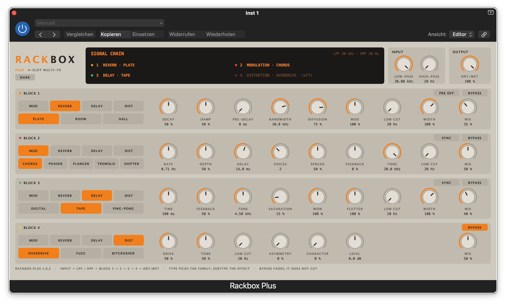
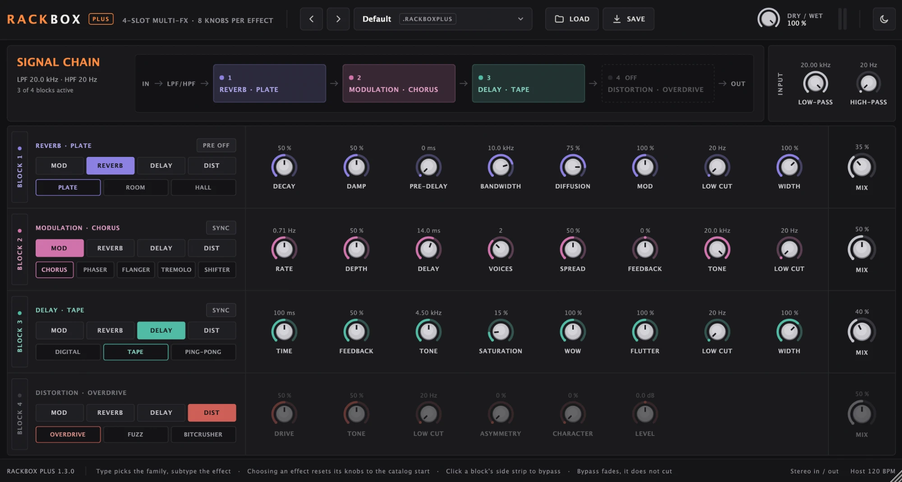

# Rackbox Plus

Rackbox with more to turn: the same four-slot multi-effect for macOS - AU (aufx/Rbxp/Tzor),
VST3 and a standalone app, built with JUCE 9 - but every effect gets up to eight knobs instead
of two, and the four blocks sit as rows one under the other. A separate plugin with its own
identity, so Rackbox stays as lean as it is.

Family: [Kitbox](https://github.com/TZorr/Kitbox) (16-pad drum sampler), [Rackbox](https://github.com/TZorr/Rackbox) (four-slot multi-effect), [FMBox](https://github.com/TZorr/FMBox) (eight-sound FM drum synth), [Chordbox](https://github.com/TZorr/Chordbox) (16-pad chord generator), [Transmute](https://github.com/TZorr/Transmute) (drum resynthesis).

**Dark** under the wordmark switches the panel to dark; the choice is yours,
not the session's - every Rackbox Plus window and project opens the way you left it.

## Install

Download `Rackbox.Plus.1.0.2.pkg` from
[Releases](https://github.com/TZorr/RackboxPlus/releases) and run it; choose AU, VST3 or both - they go into `/Library/Audio/Plug-Ins`. Apple Silicon, macOS
26.5 or later. The installer is unsigned, so Gatekeeper refuses it at first:
right-click it and choose Open, or allow it under System Settings › Privacy &
Security.

## The rack

    Input -> LPF/HPF -> Block 1 -> 2 -> 3 -> 4 -> Dry/Wet -> Output

Each block loads any of 14 effects, picked by **Type** (Modulation, Reverb, Delay, Distortion)
and **Subtype** (Modulation: Chorus, Phaser, Flanger, Tremolo, Shifter; Reverb: Plate, Room,
Hall; Delay: Digital, Tape, Ping-Pong; Distortion: Overdrive, Fuzz, Bitcrusher). Every block
has Bypass, eight knobs (`p1`-`p8`, named and printed after the loaded effect; the ones it does
not have are hidden) and its own Mix at the right. Choosing another effect on the panel puts its
knobs at the catalog's starting values; a host or preset changing the Type does not. Switching
type, subtype or bypass crossfades over 30 ms. All parameters are automatable.

All four families have their full knob sets (below).

Modulation (each at its starting values is Rackbox's effect):

    Chorus    Rate, Depth, Delay 5-30 ms, Voices 1-4, Spread, Feedback +-70 %, Tone, Low Cut
    Phaser    Rate, Depth, Center 200 Hz-3.2 kHz, Feedback +-90 %, Stages 2-12, Spread, Shape, Blend
    Flanger   Rate, Depth, Delay 0.5-10 ms, Feedback +-95 %, Spread, Shape, Tone (in the loop)
    Tremolo   Rate, Depth, Shape (sine/triangle/square), Stereo (to auto-pan), Skew
    Shifter   Shift, Fine +-10 Hz, Feedback, Loop 1-200 ms, Spread (right turns the other way),
              Low Cut, High Cut

Reverb (each at its starting values is Rackbox's effect):

    Plate     Decay, Damp, Pre-Delay 0-250 ms, Bandwidth 1-20 kHz, Diffusion 0-90 %, Mod,
              Low Cut, Width 0-150 %
    Room      Size 50-200 %, Decay 0.1-4 s (RT60), Damp, Pre-Delay, Early, Mod, Low Cut, Width
    Hall      as Room, Decay 0.5-15 s

Size scales the network's lines and Decay sets the RT60 apart from it (in Rackbox one knob did
both); measured below 1 kHz the tail falls 30 dB in half the set time to within 1 dB. Early adds
eight reflections of the dry input ahead of the network. Pre-Delay adds to the PRE button.

Delay (each at its starting values is Rackbox's effect; the cuts sit inside the loop, so every
repeat is filtered again):

    Digital   Time, Feedback, Low Cut, High Cut, Offset (right +-50 %), Width, Mod Rate, Mod Depth
    Tape      Time, Feedback, Tone (4.5 kHz at start), Saturation, Wow, Flutter, Low Cut, Width
    Ping-Pong Time, Feedback, Low Cut, High Cut, Width, Swing (right bounce +-50 %), Mod Depth

Distortion (each at its starting values is Rackbox's effect; Overdrive and Fuzz stay
anti-aliased, both curves of the Overdrive included):

    Overdrive  Drive, Tone, Low Cut (before the shaper), Asymmetry (even harmonics),
               Character (soft to hard clip), Level +-12 dB
    Fuzz       Fuzz, Tone, Bias 0-0.6 (0.3 at start), Gate -80 to -20 dB, Low Cut, Level
    Bitcrusher Bits, Rate, Jitter, Pre Filter (two-pole, at the reduced Nyquist at 100 %),
               Tone, Drive 0-24 dB (clips at full scale), Level

Spread is one LFO read later on the right, so it moves the image at once. During a 30 ms
switch the effect fading out keeps its own knobs; only the one fading in follows them (the same
knob means something else in another effect).

Identity: `aufx` / `Rbxp` / `Tzor`, bundle id `TZorr.RackboxPlus`. The engine started as a copy
of Rackbox 0.5.0's `Source/Engine`; its `Effect` carries eight knobs (Rackbox's `nextA`/`nextB`
are knobs 1 and 2, so effects written for Rackbox run unchanged).

    Scripts/build.sh      build Release, run RackboxPlusCheck and EditorShot, render build/shots/rackbox-plus.png (+ one per family, rackbox-plus-dark.png)
    Scripts/install.sh    copy AU + VST3 (+ app) to ~/Library and /Applications, flush caches, run auval
    Scripts/package.sh    build + checks, then the AU/VST3 installer in build/

JUCE is expected at `~/JUCE` (or `-DJUCE_PATH=...`), with CMake and Ninja.

Layout: `Source/Engine` (Effect base class, catalog, EffectBlock, input filters,
`Effects/` one class per effect), `Source/UI` (Palette and Knob, block rows, display),
`Verification/` (engine measurements, processor checks + render).

Overdrive and Fuzz are anti-aliased without oversampling (first-order antiderivative
anti-aliasing, `Dsp::Adaa`, no latency): at full drive the harmonics that fold back below
10 kHz sit about 20 dB lower than a plain shaper's, and the top end the averaging softens is
lifted back. The Bitcrusher aliases on purpose.

The Shifter is a single-sideband frequency shifter: Shift moves
every frequency by the same number of Hz (-1000 to +1000, 0 at the centre, finely resolved
near it), Feedback sends the result round an 8 ms loop again - a comb whose teeth move on every
pass, the barber-pole that climbs or falls for ever at small shifts. The 90-degree split is a
pair of allpass chains designed for Rackbox (`Scripts/HilbertDesign.cpp`): no latency, the
mirror sideband at least 66 dB down from 10 Hz to Nyquist - 10 Hz at 48 kHz. Being allpass,
it turns phases even at 0 Hz, so blended with the dry signal on Mix it colours like a phaser
standing still.

Delay and Modulation blocks have a SYNC button: the Time (or Rate) knob then steps
through 14 note values (1/32 to 1/1, with triplets and dotted values) at the host
tempo, or 120 BPM when the host gives none. Synced modulation is phase-locked to the
host's beat grid while the transport runs (one cycle per note value), and free-runs at
the tempo's rate when stopped. Delays are held at 4 s (a whole note at
60 BPM); slower tempi are clamped there.

Reverb blocks have a PRE button where the others have SYNC: it steps (click; right-click
back) through a pre-delay of OFF, 1/128, 1/64, 1/32, 1/16, 1/8, 1/4, 1/2 and 1 bar, computed
from the host tempo and time signature (120 BPM, 4/4 without a host); the tooltip shows the
milliseconds. Changing it is a 30 ms crossfade, not a glide. Capped at 4 s.

Channels: stereo in/out, mono in / stereo out (a mono aux through reverb or chorus widens
the source) and mono in / mono out (the stereo chain is folded to mono). The AU reports
[1,1] [1,2] [2,2].

## Presets

**PRESETS** beside the Dark switch opens the plugin's own preset menu. It lists `~/Library/Audio/Presets/T'Zorr/Rackbox Plus/`, the folder Logic lists too, and each subfolder becomes a submenu. It also has Save Preset…, Load Preset… and Show in Finder. Presets are .aupreset files, so a preset saved in the plugin shows up in Logic's menu and the other way round. In VST3 hosts such as Bitwig this menu is the only way to load and save presets.

## Licence

Rackbox Plus is © 2026 T'Zorr and is distributed under AGPLv3 - see
[LICENSE](LICENSE). This follows from linking JUCE's free tier, which is
AGPLv3 itself; details in [THIRD_PARTY_NOTICES.md](THIRD_PARTY_NOTICES.md).

## Contact

T'Zorr - <TZorr@gmx.de>
